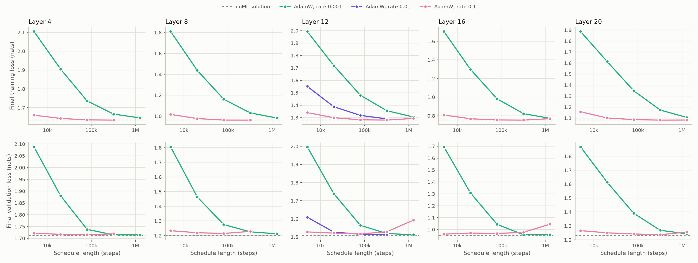
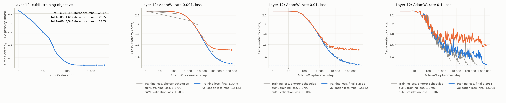

# Header-role probes on neutral passages

Status: complete; the AdamW fits did not converge (section 3.1). Date: 2026-11-10.

## 1. Motivation & RQ

The five role probes give one label to header forms the model may treat differently.
`assistant` covers the commentary text written before a tool call, the tool call itself and
the final answer; `system` covers the system and the developer message; `cot` and `tool`
each mix analysis-channel and commentary-channel messages. The header role set
([HARMONY_RENDERING.md](../../../HARMONY_RENDERING.md) section 6) gives each of the ten
Harmony header forms its own role. This experiment fits the first header-role probes and asks:

1. How well does a linear probe fitted on neutral text tell the ten header roles apart, role by role?
2. Do the two fitters give the same probe once each has converged? The earlier five-role
   fits stopped before convergence, so a difference between fitters could not be told apart
   from an unfinished fit.

The header roles are a separate role set and are reported as ten roles throughout. They are
not reduced to the five roles; five-role probes keep their own configuration and
[experiments](../gptoss20b_baseline/README.md).

## 2. Evaluation setup

**Data.** The 250 neutral web passages (C4 and Dolma, up to 1,024 tokens each) behind the
[baseline probes](../gptoss20b_baseline/README.md). Each passage is rendered ten times, once as a
single message under each header:

| Header role | Header of the rendering |
|---|---|
| `system` | `system` |
| `developer` | `developer`, the passage as its instructions |
| `user` | `user` |
| `analysis` | `assistant<\|channel\|>analysis` |
| `commentary` | `assistant<\|channel\|>commentary` |
| `final` | `assistant<\|channel\|>final` |
| `tool_call` | `assistant<\|channel\|>commentary to=functions.tool <\|constrain\|>json` |
| `tool_output` | `functions.tool<\|channel\|>commentary to=assistant` |
| `analysis_tool_call` | `assistant to=python<\|channel\|>analysis <\|constrain\|>code` |
| `analysis_tool_output` | `python to=assistant<\|channel\|>analysis` |

The text is the same in nine of the ten renderings, so there a probe can only use what the
header leaves in the activations of the text tokens. The developer rendering is the
exception: the library puts a `# Instructions` heading before the passage. Its two or three
tokens are labelled `developer` and used like any other (726 of the 140,534 developer
tokens), and every passage token after it has the heading in its context, so for
`developer` the probe can also use the heading. Every text token is one example, labelled
with the role of its rendering. 225 passages are used for fitting (1,285,716 tokens) and 25
are held out for validation (113,090 tokens); all ten renderings of a passage are on the
same side. Every role has about a tenth of the tokens, so guessing and always predicting
one role both score 10%.

**Probes.** One linear classifier per layer: ten logits computed from the 2,880-dimensional
activation that enters the MLP (after the attention layer norm) at layers 4, 8, 12, 16 and
20 of GPT-OSS-20B, counted from zero. The predicted role is the largest logit.

**Fitters and their convergence tests.**

- *cuML* minimises the mean cross-entropy plus an L2 penalty (C = 0.005) over all fitting
  tokens with L-BFGS, as in the role-probe paper. This objective has one minimum. The solver
  stops by its own criteria: when the largest gradient entry falls below the tolerance times
  the loss, or when the loss changes by less than a hundredth of that between iterations. A
  fit counts as converged when it ended in one of these two ways, and not at the iteration
  limit or on a failed line search. Each layer is fitted three times, with the solver's
  default tolerance of 10⁻⁴ and with 10⁻⁵ and 10⁻⁶; results are those of 10⁻⁴ unless stated.
  Unlike the paper's recipe, the fits run in double precision.
- *AdamW* is the fitter of training_against_probes: batches of 32 renderings, activations
  divided by their root-mean-square norm, and a learning rate that rises to a peak and then
  decays to zero over a fixed number of steps. Because the rate ends at zero, its loss curve
  always flattens, whether or not the fit is finished. A fit therefore counts as converged
  when a new fit with four times as many steps changes the final training loss by less than
  0.1%. Schedules run from upstream's 5,000 steps to 1,280,000. Two peak rates are compared:
  upstream's 0.001 and 0.1 (and 0.01 at layer 12 only).

**Metrics.** *Loss* is the mean cross-entropy per token in nats (lower is better; a uniform
guess gives 2.303). *Accuracy* is the share of tokens whose predicted role is the true one.
*Per-role accuracy* is the same share among the tokens of one true role. Each is reported
on the fitting passages (train) and the held-out passages (validation).

Two probes of one layer are compared on the validation tokens by the share of tokens given
the *same predicted role*, and through their weights: the *weight cosine* is the cosine
similarity of the two weight matrices after subtracting the mean over roles (which leaves
the probabilities unchanged), and the *norm ratio* is the norm of one matrix over the norm
of the other. Larger weights in the same direction give the same predicted roles with more
extreme probabilities. The reference in these comparisons is the cuML probe of tolerance
10⁻⁶, the closest to the minimum.

## 3. Factual observations

### 3.1 Convergence

**cuML.** Every fit stopped by the solver's own criteria: on the gradient rule at tolerance
10⁻⁴ and on the loss-change rule at 10⁻⁵ and 10⁻⁶. Each cell lists the three tolerances in
that order.

| Layer | Iterations | Training loss | Validation accuracy (%) | Same predicted role as the 10⁻⁶ probe (10⁻⁴, 10⁻⁵) |
|---:|---:|---:|---:|---:|
| 4 | 352 / 1,222 / 1,523 | 1.63435 / 1.63410 / 1.63407 | 39.15 / 39.17 / 39.16 | 98.9% / 99.9% |
| 8 | 582 / 1,900 / 4,367 | 0.96414 / 0.96379 / 0.96376 | 59.27 / 59.28 / 59.28 | 99.2% / 99.9% |
| 12 | 498 / 1,612 / 3,544 | 1.27956 / 1.27931 / 1.27928 | 49.02 / 49.04 / 49.05 | 99.3% / 99.9% |
| 16 | 941 / 3,463 / 5,437 | 0.75447 / 0.75407 / 0.75372 | 68.46 / 68.48 / 68.48 | 99.2% / 99.5% |
| 20 | 1,273 / 4,955 / 8,774 | 1.08276 / 1.08216 / 1.08204 | 58.33 / 58.37 / 58.37 | 99.1% / 99.8% |

A tolerance a hundred times tighter takes 4 to 8 times as many iterations. It lowers the
training loss by 0.02% to 0.10%, moves validation accuracy by at most 0.04 points and
per-role validation accuracy by at most 0.2 points, and changes the predicted role of 0.7%
to 1.1% of validation tokens. At 10⁻⁶ layers 16 and 20 need more than the paper's limit of
5,000 iterations.

**AdamW.** No setting met its test at every layer. Each cell below is the training /
validation loss at the end of a schedule; "change" is the change of the training loss from
the schedule a quarter as long. The cuML column is the fit at tolerance 10⁻⁴.

| Layer | cuML | AdamW 0.001, 1.28M steps | Change | AdamW 0.1, 320k steps | Change | AdamW 0.1, 1.28M steps | Change |
|---:|---:|---:|---:|---:|---:|---:|---:|
| 4 | 1.6344 / 1.7119 | 1.6457 / 1.7146 | −1.24% | 1.6342 / 1.7191 | −0.08% | not run | |
| 8 | 0.9641 / 1.2006 | 0.9823 / 1.2121 | −4.96% | 0.9621 / 1.2288 | −0.05% | not run | |
| 12 | 1.2796 / 1.5082 | 1.3049 / 1.5123 | −3.85% | 1.2799 / 1.5289 | −0.17% | 1.2931 / 1.5928 | +1.02% |
| 16 | 0.7545 / 0.9498 | 0.7718 / 0.9564 | −6.63% | 0.7533 / 0.9764 | −0.24% | 0.7691 / 1.0449 | +2.05% |
| 20 | 1.0828 / 1.2313 | 1.1054 / 1.2437 | −6.12% | 1.0811 / 1.2367 | −0.43% | 1.0819 / 1.2565 | +0.07% |

- **Upstream rate (0.001).** The training loss is still falling after 1,280,000 steps, 256
  times upstream's schedule: the last quadrupling lowered it by 1.2% to 6.6%, and it ends
  0.7% to 2.3% above the cuML loss. After upstream's own 5,000 steps it is 1.70 to 2.10,
  not far below the 2.303 of a uniform guess.
- **Rate 0.1.** The training loss is within 0.21% of the cuML loss after 320,000 steps at
  every layer, but it does not settle. The test passes at layers 4 and 8 (80,000 against
  320,000 steps) and at layer 20 (320,000 against 1,280,000). At layers 12 and 16 the
  1,280,000-step fit ends 1.0% and 2.1% *higher* than the 320,000-step fit. The validation
  loss rises with the longer schedule at every layer, also where the test passes: by 0.2%
  and 1.2% at layers 4 and 8 (from 80,000 to 320,000 steps) and by 4.2%, 7.0% and 1.6% at
  layers 12, 16 and 20 (from 320,000 to 1,280,000 steps).
- **Rate 0.01** (layer 12 only): training loss 1.2892 after 320,000 steps, still falling
  (−2.2%).

No AdamW fit is therefore treated as converged below. The AdamW probes compared with cuML
are those of the longest schedule run at each rate: 1,280,000 steps, or 320,000 steps for
rate 0.1 at layers 4 and 8.

*Loss at the end of each AdamW schedule against its length (top: training, bottom:
validation). The dashed line is the cuML solution. A converged fitter would be flat at the
right end.*

*Layer 12. Left: the cuML objective per iteration for the three tolerances, with a dot where
each fit stopped. Right: AdamW training and validation loss per step for the longest schedule
at each rate, with shorter schedules in grey and the cuML losses (tolerance 10⁻⁴) dashed. All
layers: [plots/loss_curves.png](plots/loss_curves.png).*

### 3.2 The fitters compared

Accuracy (train / validation, in percent; guessing gives 10):

| Layer | cuML | AdamW, rate 0.001 | AdamW, rate 0.1 |
|---:|---:|---:|---:|
| 4 | 42.0 / 39.2 | 41.6 / 38.9 | 42.0 / 39.1 |
| 8 | 66.7 / 59.3 | 66.1 / 58.8 | 66.7 / 59.3 |
| 12 | 55.8 / 49.0 | 54.9 / 48.6 | 55.7 / 49.0 |
| 16 | 74.0 / 68.5 | 73.5 / 68.1 | 74.0 / 68.4 |
| 20 | 63.0 / 58.3 | 62.2 / 57.8 | 63.0 / 58.2 |

Agreement of each AdamW probe with the cuML probe of tolerance 10⁻⁶ of its layer:

| Layer | Same predicted role, rate 0.001 | Rate 0.1 | Weight cosine, rate 0.001 | Rate 0.1 | Norm ratio, rate 0.001 | Rate 0.1 |
|---:|---:|---:|---:|---:|---:|---:|
| 4 | 90.9% | 97.5% | 0.947 | 0.999 | 0.92 | 1.04 |
| 8 | 93.1% | 98.0% | 0.963 | 0.997 | 0.94 | 1.16 |
| 12 | 90.2% | 96.2% | 0.931 | 0.997 | 0.82 | 1.19 |
| 16 | 94.7% | 97.9% | 0.947 | 0.994 | 0.91 | 1.33 |
| 20 | 92.5% | 97.4% | 0.921 | 0.996 | 0.84 | 1.11 |

Validation accuracy is 0.2 to 0.6 points below cuML at rate 0.001 and within 0.1 points at
rate 0.1; per-role validation accuracy differs from cuML by at most 2.8 points at either
rate. The rate-0.1 weights point in almost the cuML direction but are 4% to 33% larger; the
rate-0.001 weights are 6% to 18% smaller and less aligned. For comparison, the cuML probes
of the two looser tolerances agree with the reference on 98.9% to 99.9% of tokens.

### 3.3 Accuracy by role

Validation accuracy of the cuML probes (tolerance 10⁻⁴) by true role, in percent:

| Role | Layer 4 | Layer 8 | Layer 12 | Layer 16 | Layer 20 |
|---|---:|---:|---:|---:|---:|
| `system` | 31.5 | 51.3 | 40.8 | 59.9 | 44.5 |
| `developer` | 62.2 | 84.3 | 77.1 | 93.3 | 83.5 |
| `user` | 42.2 | 73.2 | 58.0 | 86.9 | 81.5 |
| `analysis` | 21.0 | 44.1 | 34.9 | 58.7 | 46.4 |
| `commentary` | 20.9 | 41.8 | 34.8 | 57.3 | 47.7 |
| `final` | 24.3 | 88.1 | 86.7 | 93.2 | 86.8 |
| `tool_call` | 64.2 | 61.7 | 46.3 | 82.4 | 75.0 |
| `tool_output` | 39.9 | 48.8 | 42.8 | 55.9 | 42.5 |
| `analysis_tool_call` | 44.7 | 51.5 | 41.3 | 53.2 | 46.3 |
| `analysis_tool_output` | 40.4 | 47.8 | 27.3 | 43.7 | 28.9 |
| **All tokens** | 39.2 | 59.3 | 49.0 | 68.5 | 58.3 |

- Layer 16 is the most accurate and layer 12 is less accurate than layer 8.
- From layer 8 on, `final` and `developer` are recognised best (87% to 93% and 77% to 93%),
  followed at layers 16 and 20 by `user` and `tool_call` (75% to 87%). The other six roles
  stay between 27% and 60% at these layers; `analysis_tool_output` is the lowest from layer
  12 on.
- At layer 16 the errors go mostly to the four tool roles. Tokens of `tool_output`,
  `analysis_tool_call` and `analysis_tool_output` are assigned to another tool role in 29%
  to 33% of cases (`tool_call` alone receives 12% to 16%), and `system`, `analysis` and
  `commentary` tokens are assigned to a tool role in 25% to 27% of cases.
- `commentary` and `final`, both `assistant` in the five-role set, are almost never taken
  for each other at layer 16 (2.1% and 0.9%). `commentary` is taken for `analysis` (8.0%)
  and for the tool roles more often than for `final`.
- Train accuracy is 3 to 7.5 points above validation accuracy over all tokens, and up to 19
  points above it for single roles (`analysis` at layer 8: 62.6% against 44.1%).

Confusion tables for every layer, fitter, tolerance and split:
[APPENDIX.md](APPENDIX.md#layer-16-cuml-validation). Per-role train accuracy, the other cuML
tolerances and the AdamW probes: [metrics/tables.md](metrics/tables.md).

## 4. Message — interpretation and conclusion

1. **Separability.** A header alone leaves a linearly readable trace in the text tokens
   under it, but unevenly. At layer 16 the probe finds `developer`, `final`, `user` and
   `tool_call` text in 82% to 93% of tokens, and the other six roles in 44% to 60%, all far
   above the 10% of guessing. The weak roles are confused mainly with each other and with
   the tool roles, so the split into analysis-channel and commentary-channel tool roles is
   the least reliable part of the set. `commentary` is clearly separate from `final`, so
   the model does not represent the two header forms that the five-role set calls
   `assistant` in the same way.
2. **Fitters.** The question cannot be answered as posed, because only cuML met its
   convergence test. For cuML the tolerance hardly matters: a hundred times tighter moves
   accuracy by at most 0.04 points and about 1% of predictions. The AdamW fitter is still
   improving after 256 times upstream's schedule at upstream's rate, and at a rate high
   enough to reach the cuML training loss its result depends on the schedule length. What
   the unconverged fits show is that the fitters agree on the
   predicted role (96% to 98% of tokens at rate 0.1, 90% to 95% at rate 0.001) and on
   accuracy (within 0.6 points), and differ in how confident the probabilities are. For
   predicted roles and confusion tables either fitter can be used; for probabilities the
   cuML probes are the reference, because they do not depend on a schedule.

Limitations. The same neutral text sits under every header, so these numbers measure only
what the header leaves in the activations; real conversations, where each role has its own
kind of text, have not been scored with header probes, and the header probes have not been
evaluated on agentic trajectories. `developer` is the one role whose rendering differs in
text, by the library's `# Instructions` heading, which may account for part of its high
accuracy. The analysis-channel tool roles use the header forms of the built-in python tool. Validation uses 25 passages and has no confidence intervals, and
the gap between train and validation accuracy shows that the probes partly fit the 225
fitting passages. The reason for the rising loss of the longer rate-0.1 schedules was not
investigated.

[How to run this experiment](RUNNING.md)
