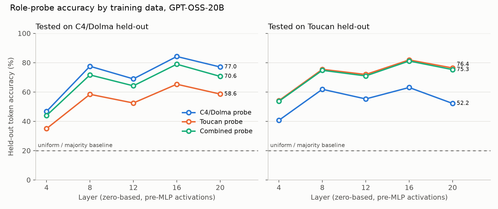

# Does probe training data matter? C4/Dolma vs Toucan role probes

Status: complete. Date: 2026-10-30.

## 1. Motivation & RQ

Neutral-text role probes recognise roles poorly on real agent histories, with tool
and system recall near zero in the [agentic transfer evaluation](../../eval_role_probes/agentic_eval/probe_scoring/probe_transfer/README.md).
Does the training text matter? We fit the same probes on tool-use text from Toucan
and on the union of both corpora, and ask whether held-out and agentic role accuracy
change.

## 2. Evaluation setup

**Training corpora.** (a) The baseline's 250 neutral C4/Dolma passages, regenerated
byte-identically from the pinned sources (documents hash `5a76ba32…`). (b) 250
Toucan-1.5M samples (`SFT` config, `single-turn-original` subset) with pairwise
disjoint MCP servers; every message of a sample is one document, giving 1,767
documents. (c) Both. Tool calls and responses use the native GPT-OSS rendering from
`trajectories/replay.py` when wrapped in their own role: calls are assistant/commentary
messages addressed to the function containing the JSON arguments, responses are
messages from that function. Every document is wrapped in all five roles exactly as
in the [baseline](../gptoss20b_baseline/README.md); messages of one token or fewer
are dropped (55 Toucan messages).

**Probes.** One L2-regularised multinomial logistic regression per layer (4, 8, 12,
16, 20) on post-attention-layernorm / pre-MLP activations of frozen GPT-OSS-20B,
cuML L-BFGS, C = 0.005, 1,024-token cap, all content tokens.

**Held-out sets.** Fixed across arms: the baseline's 25 C4/Dolma documents (11,302
tokens per role) and 25 Toucan samples with all their 176 messages (27,013 tokens per
role). Splits are grouped by document and by sample, and Toucan servers are disjoint
across samples, so no test text or server appears in training.

**Metrics.** Held-out token accuracy per collection; uniform and majority baselines
are 20% because each collection is role-balanced by construction. Clean-chat
evaluation reuses one set of 12 generated ToxicChat conversations for all probes.
Agentic evaluation scores each probe on the 168 whole AppWorld normal-test histories of
the [hx2 base cohort](../../eval_role_probes/agentic_eval/appworld/base_trajectories_hx2/README.md), one forward pass per history,
with overall token accuracy, macro recall (the mean of per-role recalls) and per-role
recall. Tool and assistant tokens make up 90% of those histories, so overall accuracy
mostly reflects those two roles.

## 3. Factual observations

The C4/Dolma arm reproduces the [published baseline](../gptoss20b_baseline/README.md)
on its own held-out set to within 0.1 points at every layer (for example 68.9% vs
68.93% at layer 12), so hardware and numerics are not a confound.

### Held-out token accuracy

| Layer | C4/Dolma probe → C4/Dolma | C4/Dolma probe → Toucan | Toucan probe → C4/Dolma | Toucan probe → Toucan | Combined probe → C4/Dolma | Combined probe → Toucan |
|---|---:|---:|---:|---:|---:|---:|
| 12 | 68.9 | 55.2 | 52.5 | 71.9 | 64.2 | 70.9 |
| 16 | 84.2 | 63.0 | 65.3 | 81.8 | 78.9 | 81.1 |

All five layers, per-role recalls and percentage confusion matrices are in
[metrics/tables.md](metrics/tables.md) and the [appendix](APPENDIX.md);
[metrics/cross_evaluation.md](metrics/cross_evaluation.md) puts training, held-out,
AppWorld and No Robots accuracy side by side per layer, and
[metrics/confusion_tables.md](metrics/confusion_tables.md) gives, per probe and data set,
the row-normalized confusion table (how each true role's tokens were predicted). The pattern
is the same at every layer: each single-corpus probe is best on its own collection
and loses 13 to 21 points on the other; the combined probe is within 1 point of the
Toucan probe on Toucan text and 4 to 6 points below the C4/Dolma probe on neutral text.

Per-role recall on the Toucan held-out set at layer 12 shows where the neutral
probe fails and what Toucan training recovers:

| Probe | System | User | Reasoning | Assistant | Tool |
|---|---:|---:|---:|---:|---:|
| C4/Dolma | 41.4 | 71.7 | 47.9 | 72.4 | 42.8 |
| Toucan | 58.5 | 82.8 | 69.3 | 75.7 | 73.2 |
| Combined | 56.9 | 83.1 | 69.7 | 76.0 | 68.9 |

### Clean chat

Eight of twelve generated conversations completed; four hit the generation cap and
are excluded, as in the baseline. Conversation-balanced mean true-role probability
at layer 12 (percent):

| Probe | System | User | Reasoning | Assistant |
|---|---:|---:|---:|---:|
| C4/Dolma | 8.9 | 86.8 | 63.5 | 99.5 |
| Toucan | 28.5 | 86.8 | 85.3 | 84.9 |
| Combined | 16.7 | 86.4 | 85.7 | 89.1 |

Token accuracy across all content tokens is 87.2%, 85.3% and 87.7% respectively.
No conversation contains tool messages, so this does not test tool recognition.

### Fit diagnostics

This cuML build emitted no line-search warnings, but the independent float64
gradient audit gives maximum absolute gradients between 9e-5 and 2e-3 across
arms and layers, the same range as the baseline fits, so no fit is certified
converged ([tables](metrics/tables.md#fit-diagnostics)).

### AppWorld histories

All 168 histories were scored by every probe set. Layer 12, percentages:

| Probe | Overall | Macro recall | System | User | Reasoning | Assistant | Tool |
|---|---:|---:|---:|---:|---:|---:|---:|
| C4/Dolma | 27.1 | 35.2 | 1.2 | 49.8 | 74.7 | 36.9 | 13.5 |
| Toucan | 52.5 | 45.9 | 10.2 | 45.7 | 72.2 | 43.6 | 57.9 |
| Combined | 38.1 | 40.3 | 2.9 | 46.7 | 79.9 | 41.7 | 30.5 |

The C4/Dolma probe reproduces the published layer pattern on this new cohort
within about one point at every layer (for example 27.1% here against 26.5%
published at layer 12). The Toucan probe is the best or near-best set at every
layer, with overall accuracy between 47% and 55% against 21% to 51% for the neutral
probe, and macro recall between 46% and 53% against 31% to 44%; its best layer is 8.
Tool recall is where the arms separate most: 13.5%, 57.9% and 30.5% at layer 12.
System tokens remain poorly recognised by every probe at layers 12 and above. The
[all-layer table](metrics/tables.md#appworld-normal-test-whole-histories-overall-accuracy-and-per-role-recall-in-percent)
and [confusion matrices](APPENDIX.md#appworld-normal-test-percentage-confusion-matrices)
show that the neutral probe mislabels most tool tokens as reasoning or assistant,
and the Toucan probe halves that confusion without creating a comparable reverse one.

## 4. Message

Training text matters, on the synthetic task and on real agent histories. A probe
fitted on neutral prose transfers poorly to tool-use text, losing most on tool,
system and reasoning tokens, and a probe fitted on Toucan text transfers equally
poorly back. On actual AppWorld histories the Toucan probe roughly doubles overall
accuracy over the neutral probe at layer 12 and raises macro recall by about ten
points, almost entirely by recognising tool tokens that the neutral probe labels
as reasoning or assistant text. The combined probe sits between the two on every
measure: it recovers most of the Toucan gain on synthetic tool-use text but only
part of it on AppWorld, and pays a few points on neutral text.

The improvement is uneven. User and reasoning recall barely move, system tokens stay
near zero for every probe at the layers that matter, and the Toucan probe trades some
assistant confidence in clean chat for its reasoning gains. Tool recall is the
single role that changes substantially, so the headline accuracy difference should be
read as "the probe now knows what tool output looks like", not as uniformly better
role recovery. Test sets are small (25 documents or samples per collection, one
benchmark of 168 tasks), fits are not certified converged, and the benchmark
histories are a fresh sample at temperature 1, so point estimates carry a few
points of noise. Extending the agentic evaluation to τ² retail and SWE-bench would
show whether the tool-recognition gain holds for other tool formats. The
[No Robots evaluation](../../eval_role_probes/chat_eval/norobots/README.md) tests the same three probe sets on
ordinary multi-turn chat and on the model's own generated reasoning.

[How to run this experiment](RUNNING.md)
