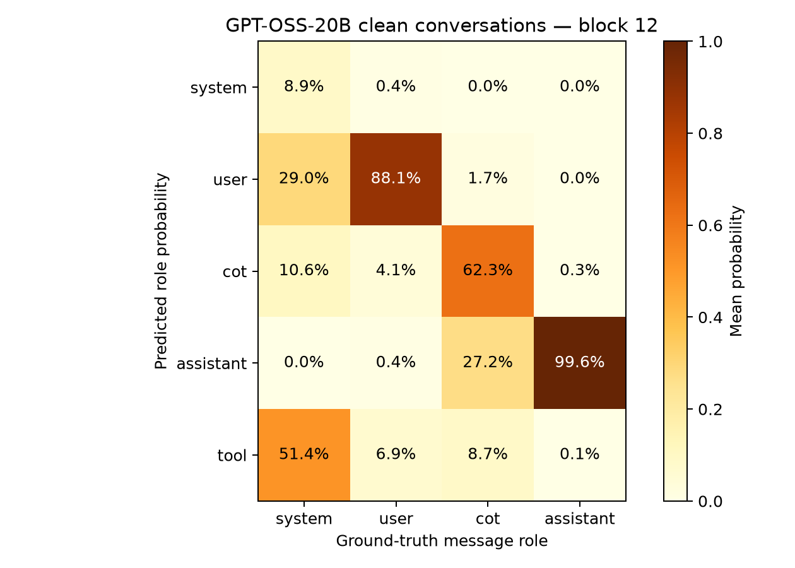
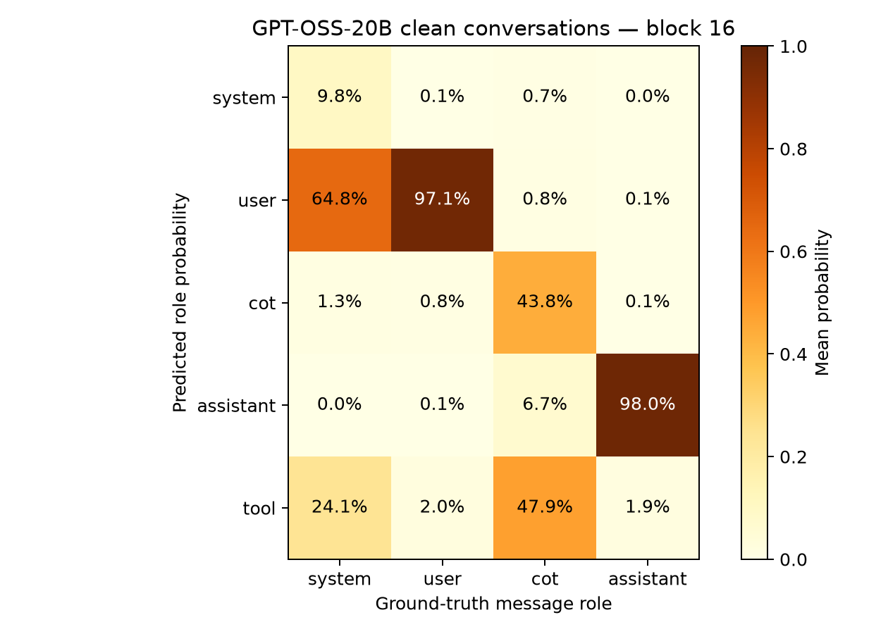

# Supporting probe results

## Held-out confusion matrices

Rows are ground truth; columns are predicted roles. Counts cover content tokens in held-out documents. `cot` means assistant reasoning. Negative log likelihood (NLL) is the mean negative log probability assigned to the true role; lower is better.

### Layer 12

NLL: 0.7903.

| True / predicted | system | user | cot | assistant | tool |
|---|---:|---:|---:|---:|---:|
| system | 7224 | 1604 | 661 | 435 | 1378 |
| user | 1864 | 8459 | 230 | 81 | 668 |
| cot | 1312 | 356 | 6297 | 1478 | 1859 |
| assistant | 290 | 26 | 868 | 9965 | 153 |
| tool | 2028 | 673 | 1201 | 391 | 7009 |

### Layer 16

NLL: 0.4027.

| True / predicted | system | user | cot | assistant | tool |
|---|---:|---:|---:|---:|---:|
| system | 9231 | 649 | 189 | 104 | 1129 |
| user | 586 | 10593 | 14 | 0 | 109 |
| cot | 359 | 47 | 8584 | 768 | 1544 |
| assistant | 15 | 20 | 554 | 10652 | 61 |
| tool | 953 | 240 | 1372 | 211 | 8526 |

## Clean-chat confusion matrices

These token-weighted counts cover only the nine completed conversations. The main report instead averages true-role probabilities equally over conversations.

### Layer 12

| True / predicted | system | user | cot | assistant | tool |
|---|---:|---:|---:|---:|---:|
| system | 36 | 140 | 27 | 0 | 310 |
| user | 0 | 396 | 18 | 0 | 25 |
| cot | 1 | 122 | 3410 | 2341 | 435 |
| assistant | 0 | 0 | 24 | 7732 | 6 |
| tool | 0 | 0 | 0 | 0 | 0 |

### Layer 16

| True / predicted | system | user | cot | assistant | tool |
|---|---:|---:|---:|---:|---:|
| system | 63 | 334 | 0 | 0 | 116 |
| user | 0 | 429 | 4 | 0 | 6 |
| cot | 141 | 39 | 2247 | 365 | 3517 |
| assistant | 1 | 27 | 0 | 7481 | 253 |
| tool | 0 | 0 | 0 | 0 | 0 |

## Probability heatmaps

Rows show true roles and columns predicted-role probabilities, averaged equally over conversations.

## Optimization diagnostics

Both fits emitted L-BFGS line-search warnings. An independent full-training-set audit measured maximum absolute objective gradients of 7.60e-4 (layer 12) and 1.66e-4 (layer 16), above the 1e-4 convergence threshold. Saved NumPy probabilities agree with cuML within 1.1e-6. See [the audit](metrics/optimizer_audit.json); no exact solver-reproduction claim is made.
